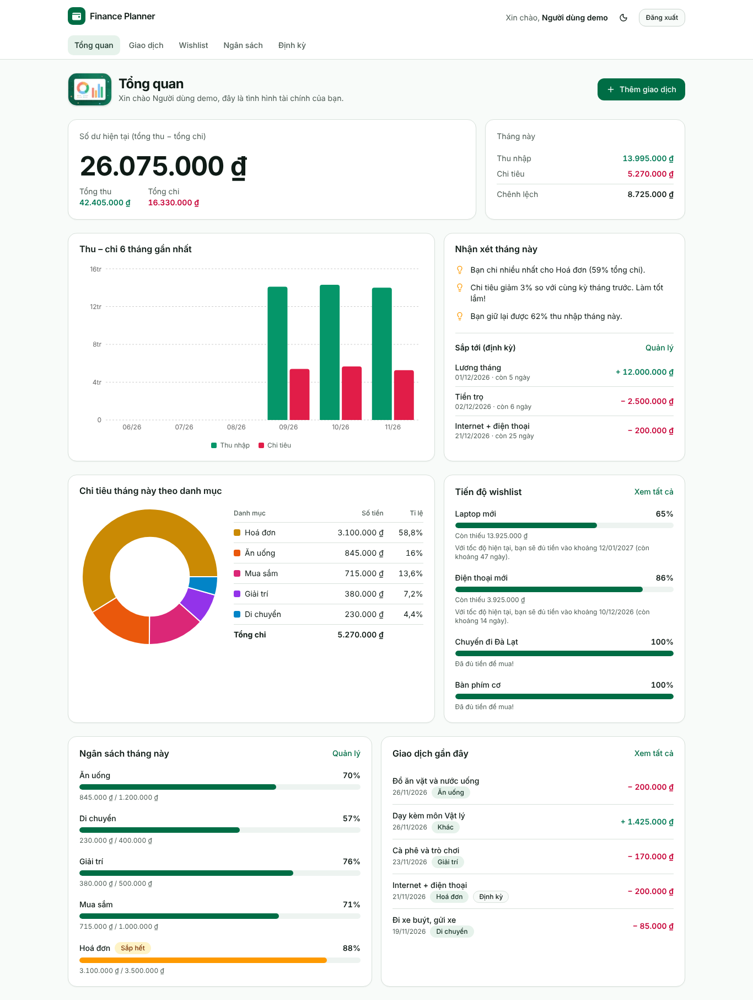
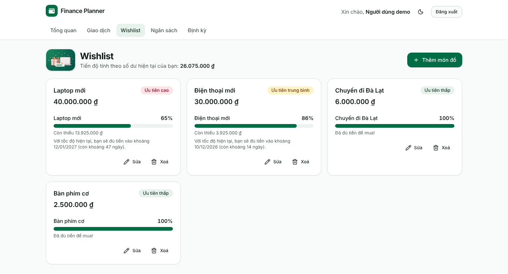

# Finance Planner

Ứng dụng web quản lý chi tiêu cá nhân: ghi thu chi theo danh mục, xem biểu đồ chi tiêu trong tháng, đặt wishlist và nhận lời chúc mừng khi tiết kiệm đạt 50% / 75% / 100% giá món đồ. Có thêm giao dịch định kỳ (tự ghi lương, tiền trọ...), dự báo ngày đủ tiền mua món đồ, biểu đồ thu – chi 6 tháng và nhận xét tháng tự động. Đồ án cá nhân môn **Phát triển ứng dụng web (PHY10615)**, HK1 2026–2027.

| | |
|---|---|
| **Production (Vercel)** | https://finance-planner-tan-seven.vercel.app |
| **GitHub** | https://github.com/hanzo-x/finance-planner |
| **Tài khoản demo** | Email: `demo@example.com` · Mật khẩu: `Demo@2026Planner` *(tạo bằng `npx prisma db seed`, xem bên dưới)* |
| **Nhật ký dùng AI** | [AI_LOG.md](./AI_LOG.md) |

## Ảnh chụp màn hình

Ảnh chụp bằng tài khoản demo với dữ liệu mẫu (45 giao dịch, 3 khoản định kỳ, 4 món wishlist, 5 ngân sách) do `prisma db seed` tạo ra.

**Tổng quan** (`/dashboard`)



**Giao dịch** (`/transactions`, có bộ lọc)


**Wishlist** (`/wishlist`, có thanh tiến độ)



**Ngân sách** (`/budgets`)


**Giao dịch định kỳ** (`/recurring`)


## Công nghệ

| Phần | Công nghệ (phiên bản) |
|---|---|
| Framework | Next.js 16.4 (App Router) + React 19 + TypeScript |
| Giao diện | Tailwind CSS v4, thành phần kiểu shadcn/ui (Radix), next-themes (sáng/tối), Sonner (toast) |
| Biểu đồ | shadcn Chart (Recharts 3) |
| Database | PostgreSQL trên Neon (Free) + Prisma ORM 7 (`prisma-client` + `@prisma/adapter-pg`) |
| Đăng nhập | Better Auth 1.7 (email + mật khẩu, GitHub) |
| Validate | Zod 4 |
| Kiểm thử | Vitest 5 + React Testing Library |
| CI / Deploy | GitHub Actions (lint, typecheck, test, build) + Vercel |

## Chạy trên máy của bạn

Cần: **Node.js 24**, Git, và một database PostgreSQL (khuyên dùng Neon miễn phí).

```bash
npm ci                              # cài thư viện (tự chạy prisma generate)
cp .env.example .env                # rồi mở .env điền các giá trị (xem giải thích trong file)
npx prisma migrate deploy           # tạo các bảng trong database (chạy các file trong prisma/migrations)
npx prisma db seed                  # tạo tài khoản demo + ~45 giao dịch mẫu + 3 khoản định kỳ
npm run dev                         # mở http://localhost:3000
```

Các bảng được tạo bằng `npx prisma migrate deploy` (áp dụng đúng các file trong `prisma/migrations/`). Hai file này được viết tay nên nếu dùng `npx prisma migrate dev` có thể gặp báo lệch (drift); khi đó hãy để Prisma tạo migration mới.

### Biến môi trường

| Biến | Dùng để |
|---|---|
| `DATABASE_URL` | Chuỗi kết nối database mà app dùng khi chạy (Neon: bản có `-pooler`) |
| `DIRECT_URL` | Chuỗi kết nối trực tiếp, dùng cho `prisma migrate` (Neon: bản không có `-pooler`) |
| `BETTER_AUTH_SECRET` | Chuỗi bí mật để ký cookie đăng nhập (cách tạo: xem `.env.example`) |
| `BETTER_AUTH_URL` | Địa chỉ gốc của web (local: `http://localhost:3000`) |
| `GITHUB_CLIENT_ID`, `GITHUB_CLIENT_SECRET` | Đăng nhập bằng GitHub (tạo OAuth App trên GitHub) |
| `SEED_DEMO_EMAIL`, `SEED_DEMO_PASSWORD` | (Tuỳ chọn) đổi tài khoản demo do seed tạo |

**Đăng nhập GitHub:** tạo OAuth App tại https://github.com/settings/developers, đặt *Homepage URL* = giá trị `BETTER_AUTH_URL` và *Redirect URI* = `<BETTER_AUTH_URL>/api/auth/callback/github` (local: `http://localhost:3000/api/auth/callback/github`), rồi điền Client ID và Client secret vào `.env`. Trên Vercel, thêm hai biến này trong *Settings → Environment Variables* rồi Redeploy.

Không bao giờ commit file `.env`. Chỉ `.env.example` (không chứa bí mật thật) được đưa lên GitHub.

### Chạy kiểm thử

```bash
npm run lint
npm run typecheck
npx vitest run          # 151 test: logic, validate, CSV, định kỳ, dự báo, route handler, component
npm run build
```

E2E bằng Playwright (`npx playwright test`): chưa có, xem *Checklist tính năng* bên dưới.

## Checklist tính năng

**Tính năng cốt lõi**

- ✅ Đăng ký / đăng nhập bằng email + mật khẩu (Better Auth), hiện tên người dùng, đăng xuất
- ✅ Đăng nhập bằng GitHub (OAuth): nút tự tắt nếu chưa có `GITHUB_CLIENT_ID` / `GITHUB_CLIENT_SECRET`; đã thử đăng nhập thật trên production
- ✅ Mọi dữ liệu thuộc về một người dùng; kiểm tra phía server ở từng page, Server Action, Route Handler
- ✅ CRUD giao dịch (số tiền VND nguyên dương, mô tả 1–120 ký tự, loại, 8 danh mục, ngày)
- ✅ Validate bằng Zod phía server, lỗi hiện dưới từng ô, toast thành công/thất bại
- ✅ CRUD wishlist (tên, giá, mức ưu tiên) + thanh tiến độ = số dư ÷ giá × 100%, giới hạn 0–100% (số dư âm → 0%)
- ✅ Dashboard: số dư nổi bật (tổng thu − tổng chi), biểu đồ tròn chi tiêu theo danh mục tháng này kèm bảng số liệu, tiến độ wishlist
- ✅ Lọc: Tháng này / Tháng trước / Tất cả, theo danh mục, theo loại; trạng thái nằm trên URL, lọc phía server
- ✅ Toast mốc tiết kiệm 50% / 75% / 100%, không báo lặp (lưu mốc đã báo trong database); logic là hàm thuần có unit test (`src/lib/milestones.ts`)

**Tính năng mở rộng**

- ✅ Ngân sách theo danh mục mỗi tháng + cảnh báo ≥ 80% và ≥ 100% (toast + trang Ngân sách + Tổng quan)
- ✅ Nhập / xuất CSV qua Route Handler (kiểm tra tiêu đề, từng dòng, dung lượng, chống CSV injection)
- ✅ **Giao dịch định kỳ** (lương, tiền trọ, internet...): khai báo một lần, app tự ghi giao dịch vào đúng ngày mỗi tháng; tạm dừng / bật lại / sửa / xoá; ghi bù khi lâu không mở; không ghi trùng kể cả khi mở nhiều tab (`src/lib/recurring.ts`, `recurring-service.ts`)
- ✅ **Dự báo** "bao giờ đủ tiền" cho từng món wishlist, dựa trên tốc độ để dành 30–90 ngày gần nhất (`src/lib/forecast.ts`)
- ✅ **Biểu đồ cột thu – chi 6 tháng** và thẻ **"Nhận xét tháng này"** tự động (danh mục chi nhiều nhất, so với cùng kỳ tháng trước, tỉ lệ giữ lại được) (`trend.ts`, `insights.ts`)
- ✅ **Pháo giấy** khi một món wishlist đạt 100% (tự vẽ bằng canvas, không thêm thư viện; tôn trọng chế độ "giảm chuyển động") (`confetti.ts`)
- ⚠️ PWA một phần: có `manifest` + icon + giao diện responsive (cài được trên trình duyệt hỗ trợ); **chưa có** service worker / chế độ offline

**Yêu cầu kỹ thuật**

- ✅ Route Handler `GET /api/transactions` trả 401 khi chưa đăng nhập (có test)
- ✅ Data Access Layer `requireUser()` (`src/lib/dal.ts`) + `proxy.ts` chặn nhanh các trang cần đăng nhập
- ✅ ≥ 8 unit test + ≥ 1 component test (xem `src/**/*.test.ts(x)`)
- ✅ GitHub Actions CI: lint, typecheck, test, build (`.github/workflows/ci.yml`)
- ✅ `AGENTS.md` có mục "Luật dự án", `AI_LOG.md`, `.env.example`
- ❌ Playwright E2E (chưa làm)
- ✅ Lighthouse (Desktop) trên production: 95–100 ở cả 4 mục, xem mục *Lighthouse*; đã quét thêm axe-core cục bộ, không còn lỗi mức nghiêm trọng

## Lighthouse

Đo trên bản production bằng Chrome DevTools (Lighthouse 13.5.0), chế độ **Desktop**. Chưa đo chế độ Mobile.

| Trang | Performance | Accessibility | Best Practices | SEO | Báo cáo |
|---|---|---|---|---|---|
| `/` (chưa đăng nhập) | 100 | 100 | 100 | 100 | [home.html](docs/lighthouse/home.html) |
| `/login` | 100 | 100 | 100 | 100 | [login.html](docs/lighthouse/login.html) |
| `/dashboard` (đăng nhập tài khoản demo) | 95 | 100 | 100 | 100 | [dashboard.html](docs/lighthouse/dashboard.html) |

Các file báo cáo là HTML: tải về rồi mở bằng trình duyệt để xem đầy đủ.

## Quyết định kỹ thuật

| Quyết định | Lý do |
|---|---|
| Tiền lưu bằng **số nguyên (Int) đồng** | Số thực có sai số (0,1 + 0,2 ≠ 0,3). Giới hạn 2 tỷ đồng/khoản để vừa kiểu Int 32-bit. |
| Ngày giao dịch lưu **00:00 UTC** của ngày đó; "tháng này" tính theo **giờ Việt Nam (UTC+7)** | Ngày không bị lệch dù server (Vercel) chạy ở múi giờ nào. Có test cho các mốc nửa đêm và tháng 12 → tháng 1. |
| Bộ lọc nằm trên **URL (`searchParams`)**, lọc bằng câu truy vấn database | Chia sẻ được link, bấm Back vẫn đúng, không cần Zustand. Giá trị bậy trên URL bị bỏ qua. |
| Giao dịch định kỳ ghi bằng cách **"ghi bù khi mở trang"**, không dùng cron | Vercel gói miễn phí không có tiến trình chạy ngầm. Mỗi lần mở trang, app tạo các lần đã đến hạn mà chưa ghi (`generatedThrough` = ngày đã ghi tới). Chống ghi trùng 3 lớp: khoá lạc quan trên `generatedThrough`, ràng buộc unique `(recurringId, date)` trong database, `createMany` + `skipDuplicates`. Có test cho ngày 31 / tháng 2 / năm nhuận, và đã thử 8 request cùng lúc. |
| Mốc tiết kiệm lưu ở cột `WishlistItem.milestone` + "khoá lạc quan" (`where milestone = giá trị cũ`) | Không báo lặp lại, kể cả khi hai request chạy cùng lúc. Nhảy từ 0% lên 80% chỉ báo mốc 75%. |
| Phân quyền: `requireUser()` trong mọi page/action, `updateMany/deleteMany` với `where: { id, userId }` | Người khác đoán được `id` cũng không sửa/xoá được dữ liệu của bạn (đã thử bằng trình duyệt). `proxy.ts` chỉ là lớp chặn nhanh, không phải chốt bảo mật chính. |
| Tắt `cacheComponents` (create-next-app 16.4 bật sẵn) | Mọi trang trong app đều là dữ liệu riêng của từng người dùng, không có gì để cache chung. |
| `<select>` gốc của trình duyệt thay cho Radix Select | Dùng bàn phím/trình đọc màn hình/điện thoại tốt sẵn, gửi cùng `<form>` không cần code thêm. |
| Prisma Client khởi tạo "lười" (`src/lib/prisma.ts`) | `next build` không cần có `DATABASE_URL`; dev không tạo thừa kết nối khi hot reload. |
| Không dùng `dangerouslySetInnerHTML` | Theo quy ước bảo mật trong `AGENTS.md`; shadcn Chart gốc dùng nó để chèn style nên đã viết lại bằng CSS variable trên thuộc tính `style`. |

## Giới hạn đã biết

Đây là giới hạn của các tính năng đã làm xong. Chỗ nào có unit test thì mình ghi kèm.

- **Danh sách giao dịch:** trang Giao dịch hiển thị tối đa 500 giao dịch mới nhất khớp bộ lọc. Muốn xem giao dịch cũ hơn thì thu hẹp bộ lọc theo tháng, loại hoặc danh mục.
- **Nhập CSV:** mỗi lần nhập tối đa 1.000 dòng và 1 MB, vượt quá thì bị từ chối (có test cho giới hạn số dòng).
- **Giao dịch định kỳ:**
  - Không có tiến trình chạy ngầm, khoản định kỳ chỉ được ghi khi có người mở trang trong app. Mở lại sau nhiều tháng thì app ghi bù các tháng thiếu, tối đa 120 lần mỗi lần mở.
  - Ngày 29–31 ở tháng ngắn thì lùi về ngày cuối tháng (ví dụ ngày 31 thành ngày 28 hoặc 29 của tháng 2).
  - Mỗi người tạo tối đa 30 khoản. Ngày bắt đầu phải nằm trong khoảng từ 2 năm trước đến 1 năm sau hôm nay.
  - Sửa một khoản định kỳ chỉ áp dụng cho các lần ghi sau, giao dịch đã ghi giữ nguyên. Không sửa được ngày trong tháng và ngày bắt đầu, muốn đổi thì tạo khoản mới.
- **Ngân sách:** mỗi danh mục chỉ có một mức ngân sách. Cảnh báo 80% và 100% chỉ hiện khi thêm một khoản chi trong tháng hiện tại bằng form. Sửa giao dịch, nhập CSV hay giao dịch định kỳ không bật cảnh báo, nhưng thanh ngân sách ở trang Ngân sách vẫn tính đủ.
- **Dự báo "bao giờ đủ tiền":** là ước tính tuyến tính theo mức để dành trung bình mỗi ngày trong 30–90 ngày gần nhất, không phải cam kết. Nếu gần đây thu chưa vượt chi thì không dự báo được, và nếu cần hơn 10 năm thì chỉ báo "hơn 10 năm" (có test cho từng trường hợp).
- **Ngày giờ:** giao dịch chỉ lưu ngày, không lưu giờ. "Hôm nay" và "tháng này" tính theo giờ Việt Nam (UTC+7), có test cho trường hợp sát nửa đêm và lúc giao tháng.
- **Dữ liệu demo:** `npx prisma db seed` xoá tài khoản demo cũ cùng toàn bộ dữ liệu của nó rồi tạo lại. Nếu `DATABASE_URL` đang trỏ vào database của bản đã deploy thì dữ liệu demo trên bản đó cũng bị đặt lại.
- **Thành phần giao diện:** các file trong `src/components/ui/` được viết tay theo phong cách shadcn/ui, không tạo bằng lệnh `npx shadcn@latest add`.

## Cấu trúc thư mục

```
prisma/              schema, migration, seed
src/app/             các trang (App Router), Server Actions (actions/), Route Handlers (api/)
src/components/      thành phần giao diện; ui/ là bộ nút, hộp thoại, biểu đồ...
src/lib/             logic: dal.ts (đăng nhập), queries.ts (database), milestones.ts, recurring.ts, forecast.ts, trend.ts, insights.ts, dates.ts, csv.ts, schemas.ts...
src/proxy.ts         chặn nhanh trang cần đăng nhập
docs/screenshots/    ảnh chụp màn hình cho README
docs/lighthouse/     báo cáo Lighthouse (HTML)
```

## Sử dụng AI

Đồ án thuộc **Mức AI 3 (AI cộng tác)**. Chi tiết từng lần dùng AI, phần mình đã kiểm chứng và sửa: [AI_LOG.md](./AI_LOG.md).
